# citerag

**Ask questions about your documents and get answers with citations you can check.**

[](https://github.com/GuiDobelin/citerag/actions/workflows/ci.yml)


citerag is a self-hostable retrieval-augmented generation (RAG) service. Upload PDFs, Word (DOCX),
Markdown, text or HTML files, then ask questions over HTTP or from the command line. Every
answer points to the exact passage, file and page it came from, so you can verify it instead of
trusting it.

```text
$ citerag ask "What notice period does the contract require?"
Either party may terminate the agreement with 60 days' written notice. [1]

Sources:
  [1] services-agreement.pdf, p. 7: "Either party may terminate this Agreement upon sixty (60) days' written notice..."
```

<p align="center">
  
</p>

<sub>The demo runs offline with the `extractive` generator; regenerate it with
`python scripts/make_demo.py`.</sub>

## Why citerag

- **Verifiable answers.** Uses Claude's built-in citations API: quotes are returned by the model
  against the retrieved passages, not pasted in afterwards.
- **Runs locally by default.** Embeddings are computed on your machine with
  [fastembed](https://github.com/qdrant/fastembed). Only the retrieved passages are sent to the LLM,
  and an offline `extractive` mode sends nothing at all.
- **Starts small, scales out.** Start with the built-in file-backed store; switch to
  [Qdrant](https://qdrant.tech) with one environment variable when you outgrow it.
- **Small and readable.** About 600 lines of typed Python, easy to fork and extend.

## Quickstart

### With Docker

```bash
git clone https://github.com/GuiDobelin/citerag && cd citerag
cp .env.example .env          # add your ANTHROPIC_API_KEY
docker compose up --build
```

The API is now at http://localhost:8000, with interactive docs at http://localhost:8000/docs.
Supported uploads are PDF, DOCX, Markdown, plain text and HTML. For Word files, the body text,
tables and text boxes are indexed; headers, footers, footnotes and comments are not (yet).

```bash
curl -F "file=@contract.pdf" http://localhost:8000/documents
curl -X POST http://localhost:8000/query \
     -H "Content-Type: application/json" \
     -d '{"question": "What notice period does the contract require?"}'
```

### With pip

```bash
pip install "citerag[local] @ git+https://github.com/GuiDobelin/citerag"
export ANTHROPIC_API_KEY=sk-ant-...

citerag ingest ./docs          # index a folder
citerag ask "Summarise the refund policy"   # streams the answer; --no-stream waits for it
citerag list                   # show indexed documents and their ids
citerag delete DOC_ID          # remove a document
citerag serve                  # start the API on :8000
```

No API key? Run `CITERAG_GENERATOR=extractive citerag ask "..."` to get the best-matching
passages back verbatim, with no LLM involved.

## API

| Method   | Path                  | Description                                          |
| -------- | --------------------- | ---------------------------------------------------- |
| `POST`   | `/documents`          | Upload a file (multipart `file`). Returns `doc_id`.  |
| `GET`    | `/documents`          | List indexed documents.                              |
| `DELETE` | `/documents/{doc_id}` | Remove a document and its chunks.                    |
| `POST`   | `/query`              | `{"question": "...", "top_k": 5, "doc_ids": [...]}`  |
| `POST`   | `/query/stream`       | Same body as `/query`; streams Server-Sent Events.   |
| `GET`    | `/health`             | Liveness check.                                      |

Both query endpoints accept an optional `mode` field: `vector`, `keyword`, or `hybrid`.
When omitted, the configured `CITERAG_RETRIEVAL_MODE` is used. The CLI supports the same
per-question override with `citerag ask "your question" --mode keyword`.

Example `/query` response:

```json
{
  "answer": "Either party may terminate the agreement with 60 days' written notice. [1]",
  "citations": [
    {
      "chunk_id": "9f2c41d07a3be2c1:14",
      "doc_id": "9f2c41d07a3be2c1",
      "source": "services-agreement.pdf",
      "page": 7,
      "quote": "Either party may terminate this Agreement upon sixty (60) days' written notice"
    }
  ],
  "model": "claude-opus-5-5"
}
```

### Streaming

`POST /query/stream` sends the answer as it is generated, as
[Server-Sent Events](https://developer.mozilla.org/en-US/docs/Web/API/Server-sent_events):

```bash
curl -N -X POST http://localhost:8000/query/stream \
     -H "Content-Type: application/json" \
     -d '{"question": "What notice period does the contract require?"}'
```

```text
event: delta
data: {"text": "Either party may terminate the agreement with 60 days' written notice."}

event: citation
data: {"index": 1, "citation": {"chunk_id": "9f2c41d07a3be2c1:14", "source": "services-agreement.pdf", "page": 7, ...}}

event: delta
data: {"text": " [1]"}

event: done
data: {"answer": "...", "citations": [...], "model": "claude-opus-5-5"}
```

`done` has the same shape as the `/query` response and is always the last event. If generation
fails before the first event, the endpoint returns `502` like `/query`; if it fails after the
stream has started, an `event: error` with `{"detail": "..."}` is sent instead of `done`.

`EventSource` only supports `GET`, so in the browser read the stream with `fetch`:

```js
const res = await fetch("/query/stream", {
  method: "POST",
  headers: { "Content-Type": "application/json" },
  body: JSON.stringify({ question: "What notice period does the contract require?" }),
});
if (!res.ok) throw new Error((await res.json()).detail); // e.g. 502 before the stream starts
const reader = res.body.pipeThrough(new TextDecoderStream()).getReader();
let buffer = "";
for (;;) {
  const { value, done } = await reader.read();
  if (done) break;
  buffer += value;
  const frames = buffer.split("\n\n");
  buffer = frames.pop(); // keep a partial frame for the next chunk
  for (const frame of frames) {
    const event = frame.match(/^event: (.*)$/m)?.[1];
    const data = JSON.parse(frame.match(/^data: (.*)$/m)?.[1] ?? "null");
    if (event === "delta") output.textContent += data.text;
    if (event === "done") showSources(data.citations);
    if (event === "error") showError(data.detail);
  }
}
```

From the command line, `citerag ask` streams by default; pass `--no-stream` to print the answer
only once it is complete.

## Configuration

All settings are environment variables (or entries in `.env`).

| Variable                   | Default                  | Notes                                            |
| -------------------------- | ------------------------ | ------------------------------------------------ |
| `ANTHROPIC_API_KEY`        |                          | Required for the `claude` generator.             |
| `CITERAG_GENERATOR`        | `claude`                 | `claude` or `extractive` (offline, no LLM).      |
| `CITERAG_CLAUDE_MODEL`     | `claude-opus-5-5`        | Any Claude model ID.                             |
| `CITERAG_CLAUDE_EFFORT`    | `medium`                 | `low` … `max`. Lower is faster and cheaper.      |
| `CITERAG_EMBEDDER`         | `fastembed`              | `fastembed` (local) or `hash` (tests only).      |
| `CITERAG_EMBEDDING_MODEL`  | `BAAI/bge-small-en-v1.5` | Any [fastembed model][models]. For non-English documents, pick a multilingual one. |
| `CITERAG_STORE`            | `memory`                 | `memory` (file-backed) or `qdrant`.              |
| `CITERAG_DATA_DIR`         | `./data`                 | Where the `memory` store persists.               |
| `CITERAG_QDRANT_URL`       |                          | e.g. `http://qdrant:6333`.                       |
| `CITERAG_CHUNK_SIZE`       | `1000`                   | Characters per chunk.                            |
| `CITERAG_CHUNK_OVERLAP`    | `150`                    | Overlap between chunks.                          |
| `CITERAG_TOP_K`            | `5`                      | Chunks retrieved per question.                   |
| `CITERAG_RETRIEVAL_MODE`   | `hybrid`                 | `hybrid` (BM25 + vectors), `vector` or `keyword`. |
| `CITERAG_RRF_K`            | `60`                     | Reciprocal Rank Fusion constant for `hybrid`.    |
| `CITERAG_RERANKER`         | `none`                   | `none` or `fastembed` (local cross-encoder).     |
| `CITERAG_RERANK_MODEL`     | `Xenova/ms-marco-MiniLM-L-6-v2` | Any [fastembed reranker][rerankers]. Use `jinaai/jina-reranker-v2-base-multilingual` for non-English documents. |
| `CITERAG_RERANK_CANDIDATES` | `20`                    | Chunks the reranker rescores (at least `top_k`). |
| `CITERAG_MAX_UPLOAD_MB`    | `25`                     | Upload size limit.                               |

[models]: https://qdrant.github.io/fastembed/examples/Supported_Models/
[rerankers]: https://qdrant.github.io/fastembed/examples/Supported_Models/#supported-rerank-cross-encoder-models

## How it works

```text
upload ─▶ load (PDF/DOCX/MD/HTML) ─▶ chunk ─┬▶ embed (local) ─▶ vector store ─┐
                                            └▶ BM25 keyword index ────────────┤
                                                                              │
question ─▶ vector + keyword search ─▶ RRF ─▶ (rerank) ─▶ top-k chunks ◀──────┘
                                                            │
                                                            ▼
          Claude (each chunk sent as a citable document) ─▶ answer + quotes
```

Retrieval is **hybrid** by default. Vector search finds passages that mean the same thing as
the question; BM25 finds exact terms that embeddings tend to blur, such as error codes, names
or IDs. Each side returns `4 × top_k` candidates and the two rankings are merged with
[Reciprocal Rank Fusion][rrf] (`score = Σ 1 / (60 + rank)`), which only looks at positions, so
the two scores never need calibrating. The keyword index is kept in memory and rebuilt from the
store when the app starts.

[rrf]: https://plg.uwaterloo.ca/~gvcormac/cormacksigir09-rrf.pdf

Reranking is optional. With `CITERAG_RERANKER=fastembed`, a small cross-encoder reads the
question together with each of the best 20 candidates and reorders them before the top `k`
go to Claude. Embeddings compare the question and a passage that were encoded separately; a
cross-encoder sees both at once, so it is better at telling a passage that *answers* the
question from one that merely shares its words. It costs latency (about 0.3 s per question
for 20 full-size chunks on a laptop CPU with the default model), and the model (~90 MB) is
downloaded on first use.

Documents are identified by a hash of their content, so uploading the same file twice replaces
it instead of duplicating it.

## Scaling

- **More documents:** set `CITERAG_STORE=qdrant`. `docker compose --profile qdrant up` starts
  one alongside the API.
- **More traffic:** with Qdrant the vectors live outside the API, so you can run several
  replicas behind a load balancer. The BM25 index is per process, though: a replica only sees
  keyword matches for documents it ingested itself or that existed when it built the index
  (on its first query). The same applies to a running API when you ingest into the same
  Qdrant with the CLI. Until the keyword index is shared, use `CITERAG_RETRIEVAL_MODE=vector`
  in those setups, or restart the API after ingesting.
- **Costs:** lower `CITERAG_CLAUDE_EFFORT` or `CITERAG_TOP_K`, or use a smaller model.

## Roadmap

- [ ] Background ingestion queue for large uploads
- [x] Hybrid search (BM25 + vectors with RRF)
- [x] Optional cross-encoder reranking
- [x] Streaming answers (SSE)
- [ ] API keys and per-tenant collections
- [ ] Evaluation harness for retrieval quality
- [x] DOCX loader
- [ ] Ingest web pages by URL

Ideas and pull requests are welcome. See [CONTRIBUTING.md](CONTRIBUTING.md).

## Ecosystem

Small, standalone tools built alongside citerag:

- [llm-cost](https://github.com/GuiDobelin/llm-cost): estimate token counts and API cost per
  model from the CLI or Python, including prompt-cache and long-context pricing.
- [bm25-tiny](https://github.com/GuiDobelin/bm25-tiny): Okapi BM25 / BM25+ keyword search in
  pure Python with no dependencies, with incremental updates, JSON persistence and a CLI.

## Development

```bash
python -m venv .venv && source .venv/bin/activate
pip install -e ".[dev]"
pytest
ruff check . && ruff format --check .
```

If you change the CLI output, regenerate the README demo with `python scripts/make_demo.py`;
a test fails while `docs/demo.svg` is out of date.

Tests use a fake LLM client and a hashing embedder, so they run offline and free.

## License

[MIT](LICENSE)
